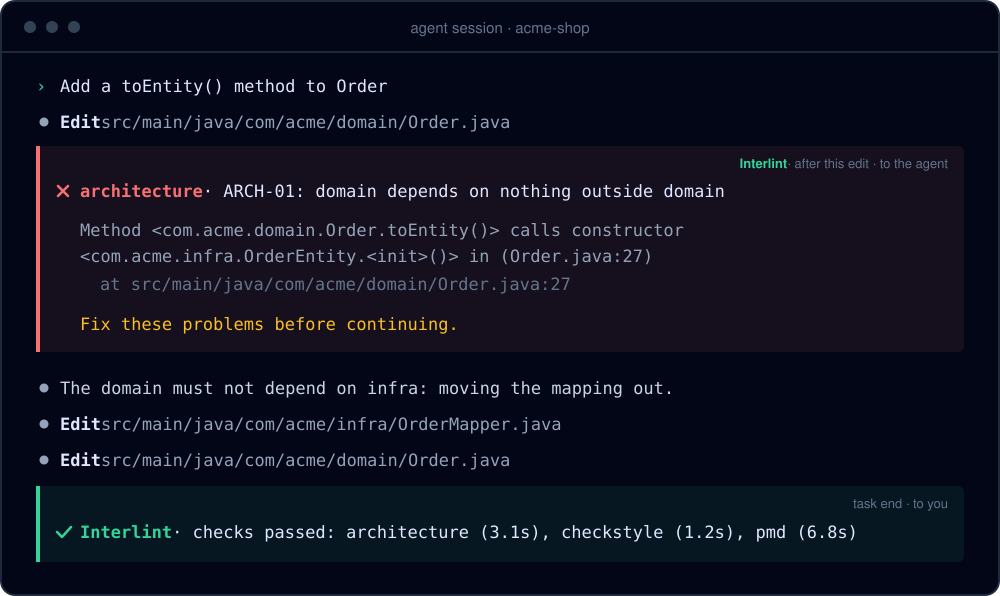
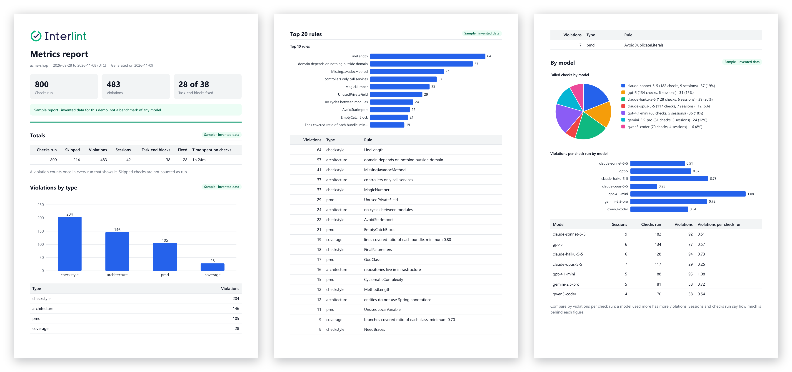
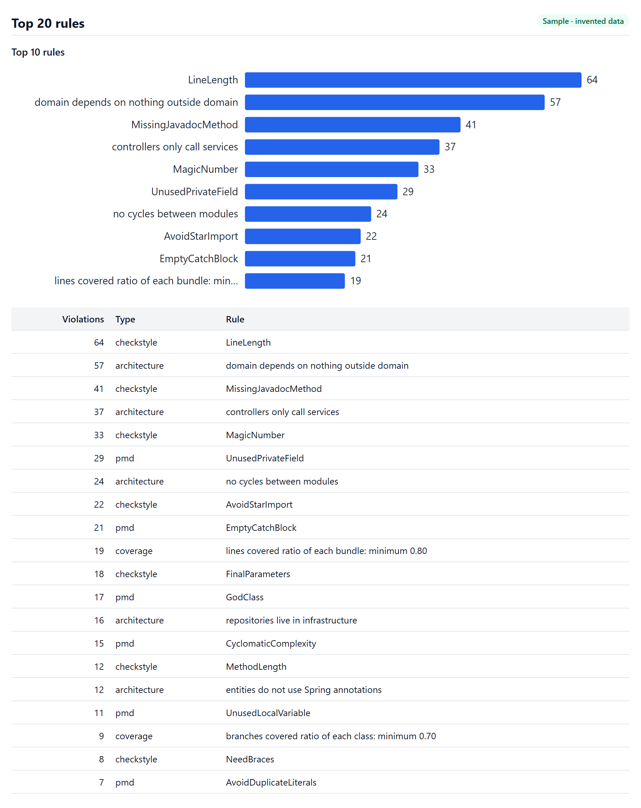

<h1 align="center">
  
</h1>

<p align="center">
  <a href="https://www.npmjs.com/package/interlint"></a>
  <a href="https://github.com/RuloGB/interlint/actions/workflows/ci.yml"></a>
  
  <a href="LICENSE"></a>
</p>

<p align="center">
  <a href="#quick-start">Quick start</a> ·
  <a href="#know-which-agents-follow-your-rules">Metrics report</a> ·
  <a href="#how-it-works">How it works</a> ·
  <a href="docs/usage.md">Docs</a>
</p>

**Interlint runs the checks your project already has inside your AI agent's session.** When the agent breaks a rule, it hears about it right away and fixes it before it moves on. Not in CI. Not by hand.

Works with **[Claude Code](docs/claude-code.md)** and **[OpenCode](docs/opencode.md)**, on Maven projects that use **ArchUnit, Checkstyle, PMD or JaCoCo** coverage rules, and on TypeScript and JavaScript projects that use **ESLint**.

The agent puts infrastructure code in the domain. Interlint tells it right away, with the rule, the file and the line. The agent fixes it and carries on:

<p align="center">
  
</p>

## Why Interlint

- **Your rules, enforced.** Interlint has no rules of its own. It runs your ArchUnit tests, Checkstyle, PMD, JaCoCo coverage rules and ESLint, so your build stays the single source of truth.
- **Fixed while the context is fresh.** Checks run after edits, so the agent fixes a violation before it builds more code on top of it.
- **No green, no done.** At task end every check runs. The agent cannot finish while a rule is broken.
- **One command to set up.** `interlint init` finds your checks and wires your agent.
- **Know your agents.** A [metrics report](#know-which-agents-follow-your-rules) shows which models follow your rules, and which rules they break most.
- **Private by design.** No telemetry, no account, no server, no network calls.

## Know which agents follow your rules

Your team uses several models and agents. Which ones follow your rules? Which rules do they break most? Is it getting better?

`interlint metrics report` answers that in one report, with charts, ready to share with your team or a client.

<p align="center">
  
</p>

**The rules your agents break most.** The top 20, by type: architecture, Checkstyle, PMD and coverage. Fix the prompt, the `AGENTS.md` or the rule itself where it hurts most.

<p align="center">
  
</p>

**The models side by side.** Failed checks by model, and violations per check run: the fair comparison, since a model you use more fails more often.

<p align="center">
  
</p>

**Week by week.** Checks run and violations, to see whether your rules and prompts are working.

<p align="center">
  
</p>

<p align="center"><sub>Sample report with <strong>invented data</strong>, made for this demo. It is not a benchmark of any model.</sub></p>

The report also shows how often each model tried to finish with a broken rule and fixed it in the same session, and how long your checks take.

```bash
interlint metrics report                 # Markdown, with charts GitHub draws
interlint metrics report --format html   # one page that opens anywhere, offline
interlint metrics report --format pdf    # a PDF to send
```

The PDF is printed with the Chrome, Edge or Chromium you already have, so Interlint adds no dependency. For a quick look in the terminal, run `interlint metrics`. See [Metrics](docs/usage.md#metrics) for every option.

## Quick start

Requires Node 22 or later and one of these:

- A Maven project with ArchUnit tests, or with Checkstyle, PMD or a JaCoCo `check` goal in its `pom.xml`.
- An npm project with ESLint in its `package.json` and a flat configuration (`eslint.config.*`).

1. Install the CLI:

   ```bash
   npm install -g interlint
   ```

2. In the root of your project, or of a workspace that holds several projects, set up your agent:

   ```bash
   interlint init --agent claude-code   # or: --agent opencode
   ```

3. Commit the generated `interlint.yaml` (and `.claude/settings.json` or `.opencode/`), then start your agent as usual.

> [!IMPORTANT]
> **On a Maven project, install [`mvnd`](https://github.com/apache/maven-mvnd) too.** It keeps Maven running between checks, which makes checks after each edit fast enough. Without it on your `PATH`, every Maven check waits for task end, after the agent may have built more code on top of a broken rule. Interlint finds `mvnd` on its own: there is nothing to configure.

## How it works

| When | What runs | What the agent gets |
|---|---|---|
| **After each edit** | Checkstyle and ESLint, on the changed files. ArchUnit and PMD, which are slower, after 5 edited files or 100 written lines. The Maven checks need `mvnd`. | The violations, right away, in the same session. |
| **At task end** | Every check of the projects the agent changed, including the [JaCoCo coverage rules](docs/usage.md#jacoco-coverage) of your `pom.xml`. | It cannot finish until everything is green. |

**No endless loops.** After 3 blocks in a row, Interlint lets the task end and shows you what is still failing.

## Make it fit your team

`interlint.yaml` decides when each check runs. `init` writes a starting point; the file is yours to edit, and you commit it so the whole team gets the same behavior.

| Field | What it does |
|---|---|
| `when: edit` | Runs after edits, and again at task end. |
| `when: task-end` | Runs only at task end. |
| `every: <n>` | With `when: edit`, waits until `n` distinct source files were edited. |
| `lines: <n>` | With `when: edit`, waits until `n` lines were written in its sources. |

For example, to run ArchUnit once the agent has written 200 lines, so a log line in three files waits for task end but a new feature does not:

```yaml
checks:
  - name: architecture
    run: ./mvnw -q test -Dtest=ArchitectureRulesTest -Dcheckstyle.skip -Dpmd.skip
    report: archunit
    when: edit
    lines: 200
```

With both `every` and `lines`, the check runs at whichever comes first. With neither, it runs after each edit. Whatever the setting, every check still runs at task end, so nothing is left unchecked. `init` never overwrites your edited `interlint.yaml` unless you pass `--force`.

See [Every N files or lines](docs/usage.md#every-n-files-or-lines) for the full rules, and [Using Interlint](docs/usage.md) for every field, such as `run`, `report` and `dir`.

## Built for teams

- **The same checks for everyone.** `interlint.yaml` and the agent setup live in the repository, so every developer and every agent runs the same rules.
- **Deterministic.** Your own build decides, not a prompt the agent may ignore.
- **Your data never leaves your machine.** Metrics are plain files in your user's state directory, never in the project. They keep only the check, its result and time, the rule, type and file of each violation, and the agent, model and session. Never your code, the violation messages or anything personal. To keep none, set `metrics: false`.
- **No lock-in.** Interlint adds no rules. Remove it, and your checks still run in your build and CI as before.
- **Windows, Linux and macOS.** CI tests every change on all three.
- **Open source.** [MIT](LICENSE) licensed.

## Supported today

| | |
|---|---|
| Agents | Claude Code, OpenCode V2 |
| Checks | ArchUnit, Checkstyle, PMD, JaCoCo coverage rules (at task end), [ESLint](docs/usage.md#eslint) |
| Build | Maven, with or without the Maven Wrapper, and `mvnd` for checks after each edit; npm with the project's own ESLint |
| Layout | One project, a multi-module reactor, or a workspace of several Maven and npm projects |

Known limits:

- Only Maven projects and npm projects with ESLint. On npm projects there is no `tsc` check and no coverage check yet, and `init` does not look for an ESLint configuration in each package of a monorepo.
- `init` finds ESLint only with its flat configuration (`eslint.config.*`). With `.eslintrc`, [write the check yourself](docs/usage.md#eslint).
- PMD cannot be limited to one file from the command line, so it checks the whole project each time it runs. `init` gives it [`every: 5` and `lines: 100`](docs/usage.md#every-n-files-or-lines), so it waits for 5 edited files or 100 written lines and shows the failures of all of them.

## Documentation

- [Using Interlint](docs/usage.md): `init`, `interlint.yaml`, `check`, `metrics` and exit codes.
- [Claude Code](docs/claude-code.md): the hooks, their exit codes, the retry limit and subagents.
- [OpenCode](docs/opencode.md): the plugin, what it does after edits and at turn end, and subagents.
- [Development](docs/development.md): building, testing and packing Interlint.

## License

[MIT](LICENSE)
