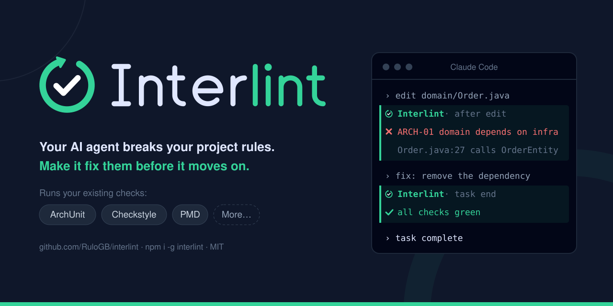
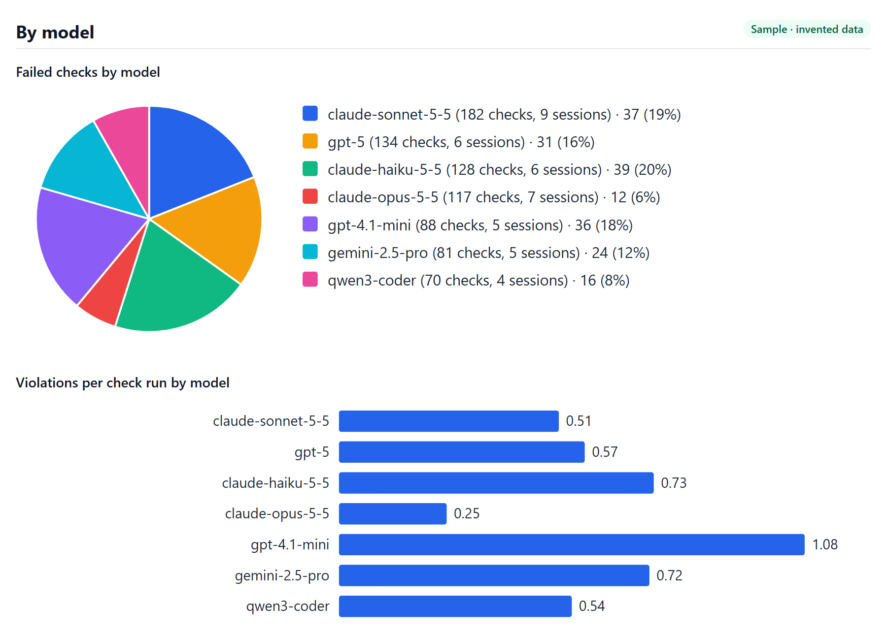
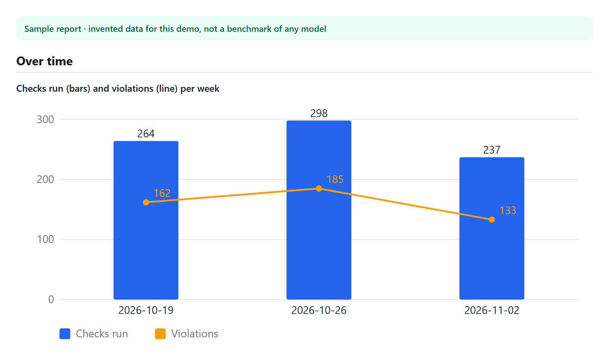

<h1 align="center">
  
</h1>

Interlint runs the checks your project **already has**, such as ArchUnit, inside the agent's session. When the agent breaks a rule, it hears about it right away and fixes it in the same session, not in CI and not by hand.

**Works with [Claude Code](docs/claude-code.md) and [OpenCode](docs/opencode.md)**, on Maven projects that use ArchUnit, Checkstyle or PMD.

> **Status:** 1.11.1. Stable for Maven projects, including multi-module projects and workspaces of several projects.

## The problem

Your code rules live in two places that never meet:

- **As text in `AGENTS.md`.** The agent may forget it, and nobody enforces it.
- **As checks** (ArchUnit tests, Checkstyle, PMD). The agent only hears about them when someone builds or CI fails.

By then the agent's session is over, and someone has to fix the code by hand.

## What Interlint does

- **After each edit,** Checkstyle checks the changed files and any violation goes straight back to the agent. ArchUnit and PMD, which are slower, run after 5 edited files or 100 written lines, whichever comes first. You can change when each check runs in `interlint.yaml`: see [Make it fit your team](#make-it-fit-your-team). This needs [`mvnd`](#install-mvnd-strongly-recommended).
- **At task end,** every check runs for the projects the agent changed. If a rule is broken, the agent cannot finish until everything is green.

This is what the agent sees when it puts infrastructure code in the domain:

```text
✗ architecture · ARCH-01: domain depends on nothing outside domain

  Method <com.acme.domain.Order.toEntity()> calls constructor <com.acme.infra.OrderEntity.<init>()> in (Order.java:27)
    at src/main/java/com/acme/domain/Order.java:27

Fix these problems before continuing.
```

The agent reads the rule, removes the dependency and carries on.

## Why teams use it

- **No new rules to write.** Interlint has no rules and no analysis engine of its own. Your existing checks stay the single source of truth.
- **Deterministic.** Your own build decides, not a prompt the agent may ignore.
- **Feedback when it is cheap.** The agent fixes the violation while it still has the context, before it builds on top of it.
- **One command to set up.** `interlint init` finds your ArchUnit tests and your Checkstyle and PMD plugins, and wires your agent.
- **No endless loops.** After 3 failed attempts in a row, Interlint lets the task end and shows you what is still failing.
- **Know your agents.** A [metrics report](#metrics-report) shows which models follow your rules best, and which rules your agents break most.

## Quick start

Requires Node 22 or later and a Maven project with ArchUnit tests, or with Checkstyle or PMD in its `pom.xml`.

1. Install the CLI:

   ```bash
   npm install -g interlint
   ```

2. In the root of your project, or of a workspace that holds several Maven projects, set up your agent.

   For **Claude Code**:

   ```bash
   interlint init --agent claude-code
   ```

   For **OpenCode**:

   ```bash
   interlint init --agent opencode
   ```

3. Commit the generated `interlint.yaml` (and `.claude/settings.json` or `.opencode/`), then start your agent as usual.

### Install mvnd (strongly recommended)

> [!IMPORTANT]
> Without [`mvnd`](https://github.com/apache/maven-mvnd) on your `PATH`, Interlint cannot check after each edit. Checkstyle waits for task end too, so the agent only hears about a broken rule when it tries to finish, after it may have built more code on top of it.

`mvnd` keeps Maven running between checks, which makes a check after each edit fast enough, and every check at task end faster. Install it following the instructions in [its repository](https://github.com/apache/maven-mvnd). Interlint finds it on its own: there is nothing to change in `interlint.yaml`.

## Make it fit your team

`interlint.yaml` decides what Interlint does. `init` writes a starting point; the file is yours to edit, and you commit it so the whole team gets the same behavior.

Each check says when it runs:

| Field | What it does |
|---|---|
| `when: edit` | Runs after edits, and again at task end. |
| `when: task-end` | Runs only at task end. |
| `every: <n>` | With `when: edit`, waits until `n` distinct source files were edited. |
| `lines: <n>` | With `when: edit`, waits until `n` lines were written in its sources. |

With both `every` and `lines`, the check runs at whichever comes first. With neither, it runs after each edit. Whatever the setting, every check still runs at task end for the projects the agent changed, so nothing is left unchecked.

For example, to run ArchUnit only once the agent has written 200 lines, whatever the number of files, and leave it to task end otherwise:

```yaml
checks:
  - name: architecture
    run: ./mvnw -q test -Dtest=ArchitectureRulesTest -Dcheckstyle.skip -Dpmd.skip
    report: archunit
    when: edit
    lines: 200
```

Some common choices:

- **Small edits wait for task end:** keep only `lines`, as above. A log line in three files does not run the check; a new feature does.
- **Many files, any size:** keep only `every`.
- **Fast feedback on every edit:** remove `every` and `lines`.
- **Only at the end:** set `when: task-end`.

Only added or changed lines count, not removed ones. When a check fails after an edit, it runs again after each next edit of its sources until it passes, then counts from zero. Maven checks need [`mvnd`](#install-mvnd-strongly-recommended) to run after edits. `init` never overwrites your edited `interlint.yaml` unless you pass `--force`.

See [Every N files or lines](docs/usage.md#every-n-files-or-lines) for the full rules, and [Using Interlint](docs/usage.md) for every field, such as `run`, `report` and `dir`.

## Metrics report

Your team uses several models and agents. Which ones follow your rules? Which rules do they break most? Do they fix a blocked task, or give up?

`interlint metrics report` answers that in one report, with charts, ready to share with your team or a client:

```bash
interlint metrics report                 # Markdown, with charts GitHub draws
interlint metrics report --format html   # one page that opens anywhere, offline
interlint metrics report --format pdf    # a PDF to send
```

<p align="center">
  
</p>

<p align="center">
  
</p>

<p align="center"><sub>Sample report with <strong>invented data</strong>, made for this demo. It is not a benchmark of any model.</sub></p>

The report has:

- **The models side by side.** A pie of the failed checks by model, each with the checks and sessions behind it, and bars of violations per check run. The pie shows who fails most in total; the bars are the fair comparison, since a model you use more fails more often.
- **The rules your agents break most,** by type (ArchUnit, Checkstyle, PMD) and one by one.
- **Task-end blocks:** how often each model tried to finish with a broken rule, and how often it fixed it in the same session.
- **The time your checks take,** at edit and at task end.
- **Week by week:** checks run and violations, to see whether your rules and prompts are working.

The PDF is printed with the Chrome, Edge or Chromium you already have, so Interlint adds no dependency. Without one, use `--format html` and print it from your browser.

For a quick look in the terminal, run `interlint metrics`. Both commands read the current project, or every project with `--all`, and take `--since <YYYY-MM-DD>` and `--agent`.

**Your data never leaves your machine.** Interlint has no telemetry, no account and no server, and it makes no network calls. Metrics are plain files in your user's state directory, never in the project, and the report is built from them on your machine. They keep only what the report needs: the check, its result and time, the rule, type and file of each violation, and the agent, model and session that ran it. Never your code, the violation messages or anything personal. To keep none, set `metrics: false` in `interlint.yaml`. See [Metrics](docs/usage.md#metrics) for every option.

## Supported today

| | |
|---|---|
| Agents | Claude Code, OpenCode V2 |
| Checks | ArchUnit, Checkstyle, PMD |
| Build | Maven, with or without the Maven Wrapper; `mvnd` for checks after each edit |
| Layout | One project, a multi-module reactor, or a workspace of several Maven projects (other projects in it are ignored) |

## Known limits

- Only Maven projects.
- PMD cannot be limited to one file from the command line, so it checks the whole project each time it runs. `init` gives it [`every: 5` and `lines: 100`](docs/usage.md#every-n-files-or-lines): it waits for 5 edited files or 100 written lines and shows the failures of all of them.

## Documentation

- [Using Interlint](docs/usage.md): `init`, `interlint.yaml`, `check`, `metrics` and exit codes.
- [OpenCode](docs/opencode.md): the plugin, what it does after edits and at turn end, and subagents.
- [Claude Code](docs/claude-code.md): the hooks, their exit codes, the retry limit and subagents.
- [Development](docs/development.md): building, testing and packing Interlint.

## License

[MIT](LICENSE)
